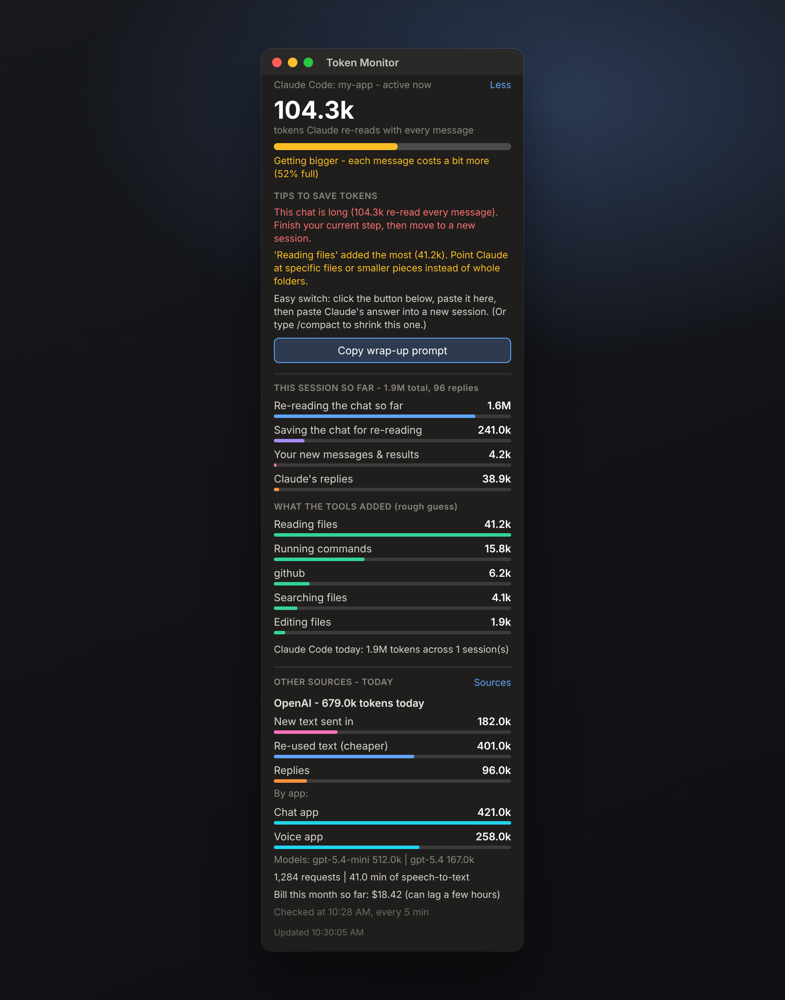

# Token Monitor

A small always-on-top window for **Windows and Mac** that shows how many AI tokens you're using, what they're being used for, and when it's time to start a fresh session to save money.

It watches **Claude Code** automatically, and you can add **OpenAI**, the **Claude API**, or **any service that has a usage link**.

There's nothing to install. It runs on tools every Windows 10/11 PC and every Mac already has.

> Unofficial community tool. Not made by or affiliated with Anthropic or OpenAI.

Example with sample numbers

---

## What it shows

**Your current Claude Code session**
- The big number: how many tokens Claude re-reads with every message. A bar fills up green, then orange, then red as the session gets heavier.
- Where the tokens went: re-reading the chat, saving the chat, your new messages, and Claude's replies. Hover over any line for a plain-English explanation.
- What the tools added: a rough guess at which tools (reading files, running commands, MCP servers) fed the most text into the chat.
- Today's total across all your Claude Code sessions.

**Tips to save tokens**

The monitor watches for expensive habits and tells you about them in plain words:
- A session that's getting too long
- One session used for days instead of one per task
- Coming back to a big session after a long break, which makes Claude re-save the whole chat
- One tool feeding in huge amounts of text

When it's time to switch, a **Copy wrap-up prompt** button appears. Paste the prompt into your old session, and Claude writes a short hand-off note. Paste that note into a new session and carry on without losing your progress.

**Other sources** (optional)
- **OpenAI**: tokens by app (project) and model, requests, speech-to-text minutes, and this month's bill
- **Claude API**: tokens by model, for apps that call Claude with your own key
- **Custom**: any service with a usage link that returns JSON

---

## Download

Click the green **Code** button at the top of this page, then **Download ZIP**, and unzip it. Inside are two folders: **windows** and **mac**.

---

## Start it on Windows

1. Open the **windows** folder.
2. Double-click **`Start Token Monitor.bat`**.
3. If Windows shows "Windows protected your PC", click **More info**, then **Run anyway**. This appears for any downloaded script.

The window appears in the top-right corner of your screen.

- **Drag** it anywhere.
- Click the **dash** button to shrink it to just the big number.
- Click **X** to close it.

## Start it on Mac

1. Open **Terminal**. Press **Cmd + Space**, type `Terminal`, and press **Return**.
2. Type `sh` followed by a space. Don't press Return yet.
3. Drag the file **`Start Token Monitor.command`** from the **mac** folder into the Terminal window. Its location fills in by itself.
4. Press **Return**.
5. When it says "Token Monitor is starting", you can close Terminal.

The window appears in the top-right corner of your screen and stays on top on every desktop.

- **Drag** it by its title bar.
- Click **Less** to shrink it to just the big number.
- Close it with the button at the top-left of its title bar.

Why the Terminal step? Files downloaded from GitHub lose their "double-click to open" permission. Starting it this way works every time.

---

## Adding OpenAI, the Claude API, or another service

Click **+ Add source** at the bottom of the window.

| Type | What you need |
|---|---|
| **OpenAI** | An **Admin key** (starts with `sk-admin-`). Make one at platform.openai.com → Settings → Organization → Admin keys. Only the organization owner can make one. Your apps' normal key won't work. |
| **Claude API** | A **Claude Admin key** (starts with `sk-ant-admin`). Make one in the Claude Console → Settings → Admin keys. Only available for organization accounts. |
| **Custom** | The service's usage link, which header the key goes in, and where the token number is in the answer (for example `data[].total_tokens`). In the link you can use `{today_unix}`, `{today_iso}`, `{month_unix}` or `{month_iso}` for the start of today or this month. |

On Mac, use the **Paste** buttons next to the key and link boxes.

Other sources are checked every 5 minutes. If one isn't working, click **Sources**, then **Open log**, to see which step failed.

---

## Privacy

- It only **reads**. It never changes your files or settings.
- Claude Code numbers come from Claude Code's own log files on your computer (`~/.claude/projects`).
- Keys are saved only on your computer and are only sent to the service they belong to:
  - **Windows:** in `%APPDATA%\ClaudeTokenMonitor`, encrypted with Windows' built-in protection so only your Windows account can read them.
  - **Mac:** in your **Keychain**, Apple's built-in password vault, under "ClaudeTokenMonitor".

---

## Settings

The settings are at the top of the main file. Open it in Notepad (Windows) or TextEdit (Mac).

- **Windows:** `windows/TokenMonitor.ps1`
- **Mac:** `mac/TokenMonitor.js`

| Setting | What it does | Default |
|---|---|---|
| Warn at | Pop-up when a session re-reads this many tokens per message | 120,000 |
| Refresh | How often the window updates | 5 seconds |
| Sources | How often to check OpenAI and other sources | 5 minutes |

---

## Good to know

- **Regular Claude chats** (claude.ai, or the desktop and mobile apps outside Claude Code) can't be monitored. They don't store token counts anywhere a program can read.
- **"What the tools added"** is an estimate, worked out at about 4 characters per token.
- **OpenAI and Claude API numbers** can run a few minutes behind. Bills can lag a few hours.
- An **MCP server** doesn't use tokens on its own. It hands text to the AI it's connected to. In Claude Code, that shows up under "What the tools added".

---

## License

MIT. See [LICENSE](LICENSE). Free to use, change and share.
